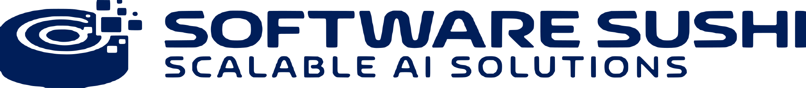
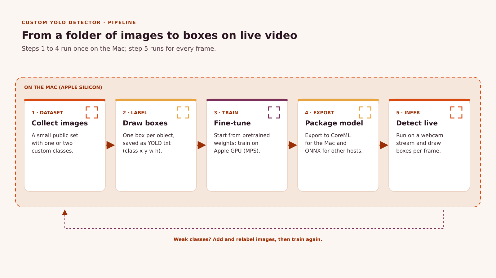
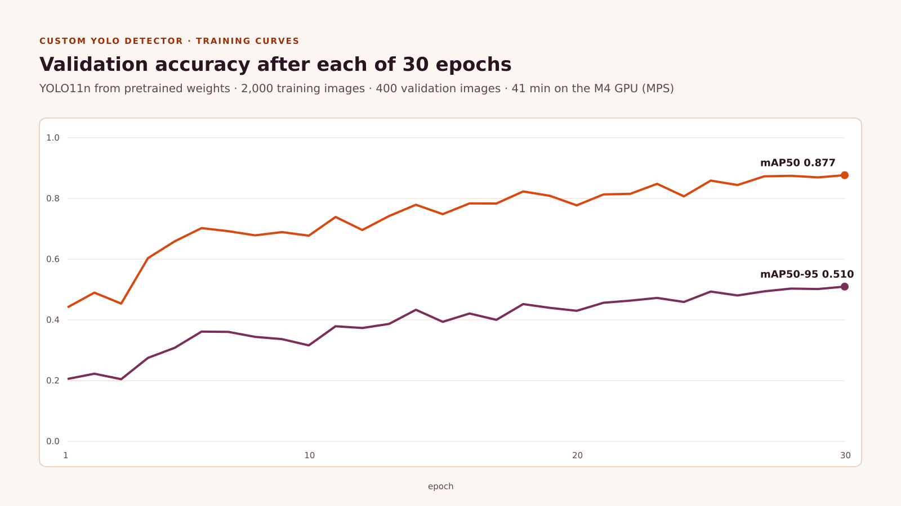

<p align="center">
  <picture>
    <source media="(prefers-color-scheme: dark)" srcset="docs/assets/logo-software-sushi-white.svg">
    
  </picture>
</p>

<h1 align="center">Custom YOLO Detector on Apple Silicon</h1>

<p align="center"><strong>Fine-tune a pretrained YOLO model on your own classes on a Mac, export it to CoreML and ONNX, and run it frame by frame on video. Every number below comes from one recorded run.</strong></p>

<p align="center">
  <a href="LICENSE"></a>
  
  
  
  <a href="https://softwaresushi.com/blog-details/object-detection-using-yolo"></a>
</p>

## Overview

This repository is the companion code for the Software Sushi article [Train a Custom YOLO Object Detector on a Mac: Dataset to Live Video](https://softwaresushi.com/blog-details/object-detection-using-yolo). It trains a two-class detector, `hardhat` and `no-hardhat`, from YOLO11n pretrained weights. The model trains on the Apple GPU through PyTorch MPS, so no cloud GPU is needed.

<p align="center"></p>

## Results

The results come from one run on 2026-10-25 on a MacBook Air with an Apple M4 and 16 GB of memory. The run used YOLO11n, 30 epochs, image size 640, batch 16, seed 0 and `device=mps`. Training took **0.685 hours (41 minutes)**.

**Held-out test split** (200 images, 534 boxes, `best.pt`):

| Class | Precision | Recall | mAP50 | mAP50-95 |
| --- | --- | --- | --- | --- |
| all | 0.864 | 0.847 | **0.894** | **0.538** |
| hardhat | 0.879 | 0.814 | 0.853 | 0.452 |
| no-hardhat | 0.849 | 0.880 | 0.934 | 0.625 |

Validation split at epoch 30 (400 images, 1,140 boxes): precision 0.847, recall 0.834, mAP50 0.877, mAP50-95 0.510.

<p align="center"></p>

**Inference speed** on the 200 test images, after 10 warm-up runs. The times include reading each JPEG and pre- and postprocessing. The raw output is in [`results/benchmark.json`](results/benchmark.json).

| Format | Images per second | ms per image |
| --- | --- | --- |
| CoreML | **142.1** | 7.0 |
| ONNX Runtime (CPU) | 54.2 | 18.4 |
| PyTorch (MPS) | 43.6 | 23.0 |
| PyTorch (CPU) | 37.8 | 26.4 |

These numbers come from one run on one small subset, so treat them as a reference point, not a benchmark. Your numbers will change with the dataset, the seed and the machine.

## Quickstart

**Prerequisites:** an Apple Silicon Mac (or Linux with an NVIDIA GPU), `git`, and **Python 3.11**. The pinned torch and coremltools versions were tested on 3.11. macOS does not ship it, so install it first with one of these:

```sh
brew install python@3.11                       # Homebrew, provides python3.11
# or
curl -LsSf https://astral.sh/uv/install.sh | sh && uv python install 3.11
```

If you use uv, create the environment with `uv venv -p 3.11 .venv` instead of the `python3.11 -m venv` line below.

```sh
git clone https://github.com/SoftwareSushi/yolo-custom-detector.git
cd yolo-custom-detector
python3.11 -m venv .venv && source .venv/bin/activate
pip install -r requirements.txt

python scripts/prepare_dataset.py   # downloads about 1.1 GB once, keeps 2,000 / 400 / 200 images
python scripts/train.py             # 30 epochs on the Apple GPU (device=mps), then scores the test split
python scripts/export.py            # writes best.mlpackage (CoreML) and best.onnx
python scripts/benchmark.py         # speed of each format, written to runs/benchmark.json
python scripts/live.py              # webcam 0, press q to quit
python scripts/live.py --source results/live-on-test-images.mp4 --save out.mp4 --no-show
python scripts/live.py --source datasets/hardhat/images/test --save out.mp4 --no-show
```

Notes:

- **Quick smoke test:** `python scripts/train.py --epochs 2` checks the whole pipeline in a few minutes. Expect a low mAP; the results above need the full 30 epochs.
- **Test score:** after training, `train.py` runs `best.pt` on the held-out test split and prints `test mAP50=... mAP50-95=... P=... R=...`. The full report goes to `runs/hardhat-test/`.
- **Pretrained weights:** the first training run downloads `yolo11n.pt` (about 5 MB) from Ultralytics into the repo folder. Git ignores it.
- **Benchmark output:** `benchmark.py` writes to `runs/benchmark.json` by default, so it does not overwrite the reference run in `results/benchmark.json`. Use `--out` to choose another path.
- **`live.py --source`** accepts a webcam index, a video file (yours or the included `results/live-on-test-images.mp4`), a folder of images, or a quoted glob such as `"photos/*.jpg"`. For images, `--fps` sets the output video rate (default 10).

To train on your own classes, label your images in any tool that exports YOLO format. Then point `scripts/train.py --data` at your own `data.yaml`.

## Project structure

```
scripts/
  prepare_dataset.py   download the dataset, convert COCO labels to YOLO and keep a fixed subset
  train.py             fine-tune from pretrained weights, then score best.pt on the test split
  export.py            export to CoreML (with NMS) and ONNX
  benchmark.py         time PyTorch MPS/CPU, CoreML and ONNX Runtime on the same images (runs/benchmark.json)
  live.py              draw boxes on a webcam stream, a video file, or a folder/glob of images
results/               training log (results.csv), plots, confusion matrices, PR curves, benchmark, demo clip
docs/assets/           diagrams and brand assets used in this README
```

The scripts write the dataset, weights and exports to `datasets/` and `runs/`. Git ignores both folders.

## Hardware notes

- **Training:** we tested on an Apple M4 (macOS 26.3.1, Python 3.11). Any Apple Silicon Mac with PyTorch MPS should work. On Linux with an NVIDIA GPU, pass `--device 0`.
- **CoreML export:** coremltools 9.0 fails with numpy 2.3 or newer, and with torch newer than 2.7.0. The error is `only 0-dimensional arrays can be converted to Python scalars`. For this reason, `requirements.txt` pins both packages.
- **Webcam:** macOS gives the camera only to apps that you allow in *System Settings > Privacy & Security > Camera*. A session started over SSH cannot get camera access. The clip in `results/` therefore plays still test images as a video.

## Dataset attribution

This project uses [Hard Hat Detection](https://huggingface.co/datasets/keremberke/hard-hat-detection), a Roboflow Universe export ("Hard Hats", 640 × 640) by its original authors, licensed under [CC BY 4.0](https://creativecommons.org/licenses/by/4.0/). The repository does not redistribute the images. `prepare_dataset.py` downloads them from the source.

## License

The code is licensed under [AGPL-3.0](LICENSE), the same license as [Ultralytics](https://github.com/ultralytics/ultralytics), which it imports. The dataset keeps its own CC BY 4.0 license.

<p align="center">
  <strong>Built by <a href="https://softwaresushi.com">Software Sushi</a></strong><br>
  AI/ML engineering and consulting: computer vision, agents and LLM applications.<br>
  <a href="https://softwaresushi.com/service-details/computer-vision-development">Computer vision development</a> · <a href="https://softwaresushi.com">softwaresushi.com</a>
</p>
